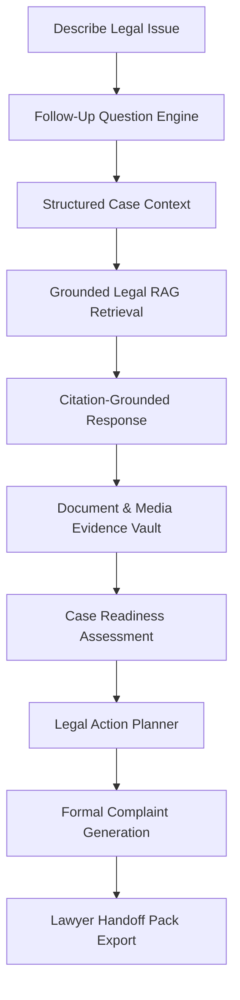

# Nyaya AI

**Nyaya AI** is an AI-powered Indian legal assistance workspace designed to help citizens understand legal issues, organize evidence, explore practical next steps, prepare formal legal complaints, and generate lawyer-ready case handoff materials using citation-grounded Retrieval-Augmented Generation (RAG).

> [!IMPORTANT]
> **Legal Information Disclaimer**: Nyaya AI provides **legal information and organizational assistance**, NOT guaranteed professional legal advice, legal representation, or a replacement for a qualified advocate. For high-stakes legal matters, users should consult a licensed legal professional.

---

## 🎯 What Nyaya AI Does

Legal information in India is often complex, scattered across statutes, difficult to interpret for non-lawyers, and challenging to connect to specific facts. Nyaya AI bridges the gap between an raw problem description and actionable legal clarity:

1. **Clarifies User Facts**: Asks targeted, single follow-up questions to resolve ambiguities without endless back-and-forth loops.
2. **Retrieves Grounded Law**: Uses local vector search and hybrid legal retrieval across verified Indian statutes to supply citation-grounded explanations.
3. **Organizes Case Evidence**: Provides a secure Evidence Vault supporting documents, images, audio, and video with SHA-256 integrity hashing and privacy protection.
4. **Assesses Case Readiness**: Computes objective factual completeness and evidence gap analysis to guide case preparation.
5. **Generates Action Plans**: Recommends prioritized, practical next steps with realistic deadlines and authority mappings.
6. **Prepares Formal Complaints & Handoffs**: Automatically builds structured legal complaints and comprehensive Lawyer Handoff Packs exported to PDF and DOCX formats.

---

## 🔄 Core User Workflow



---

## ✨ Key Features

### ⚖️ Legal Chat & Follow-Up Engine
- **Authenticated Legal Conversations**: User-owned chat sessions persisted securely in MongoDB.
- **Single Follow-Up Clarification**: Automatically identifies missing key facts and asks one clear question at a time to complete case context.
- **Citation-Grounded Answers**: Every legal assertion is backed by authoritative law sources (`[SOURCE_n]`).
- **Answer Mode Toggle**: Switch between **Simple Mode** (concise practical summaries) and **Detailed Mode** (deep legal analysis) without changing underlying legal facts or citation sources.
- **Fail-Closed Safety**: Safely declines queries that are outside supported categories or lack sufficient legal grounding rather than hallucinating law.

### 📁 Evidence Vault & Vault Protection
- **Multi-Format Upload Support**: PDF, TXT, DOCX, JPG, PNG, WEBP, MP3, WAV, M4A, MP4, WebM.
- **Cryptographic File Integrity**: SHA-256 fingerprinting calculated on upload to guarantee original evidence immutability.
- **Security Validation**: MIME signature verification, magic byte checks, file size quotas, and malware scanning boundary.
- **Privacy Controls**: Extracted text and transcripts remain private to the authenticated owner. Finalizing a complaint locks associated evidence from deletion.

### 📊 Case Readiness & Action Planner
- **Objective Readiness Score**: Measures factual and evidence completeness (NOT probability of winning in court).
- **Evidence Gap Identification**: Highlights missing documents, witness statements, or proof required to substantiate claims.
- **Prioritized Action Plans**: Generates ordered practical steps with a single primary next action, statutory timelines, and relevant legal forums.

### 📄 Complaint & Lawyer Handoff Generation
- **Structured Complaint Drafting**: Converts facts and linked evidence into formal legal complaints (draft -> generated -> edited -> finalized).
- **Lawyer Handoff Pack**: Generates a comprehensive summary pack (chronology, evidence index with SHA-256 hashes, legal statutes, unresolved questions, and recommended strategy) for legal counsel review.
- **PDF & DOCX Exports**: Export complaints and handoff packs to formatted PDF and DOCX files.

### ♿ Accessibility & Mobile Responsiveness
- **Responsive Layout**: Designed for seamless use across mobile phones, tablets, laptops, and desktop screens.
- **WCAG 2.2 AA-Oriented Polish**: Includes keyboard navigation, focus trapping in modals, Escape key handling, visible skip link, dialog ARIA roles, and minimum touch targets.

---

## 📚 Supported Legal Categories

Nyaya AI specifically supports five core domains of Indian law:

1. `consumer_rights`: Defective goods, deficiency in service, unfair trade practices, Consumer Protection Act 2019.
2. `labour_rights`: Unpaid wages, wrongful termination, workplace grievances, Industrial Disputes & Factories Acts.
3. `womens_safety`: Sexual harassment at workplace (POSH Act), domestic violence, harassment, emergency legal remedies.
4. `educational_rights`: Arbitrary fee hikes, admission disputes, degree withholding, Right to Education Act.
5. `anti_ragging`: Campus ragging, harassment, institutional non-compliance, UGC Anti-Ragging Regulations.

---

## 🏗️ System Architecture

Nyaya AI follows a modern, decoupled client-server architecture:

- **Frontend**: React 18 SPA built with Vite 8 and styled with Vanilla CSS tokens and Tailwind CSS.
- **Backend**: FastAPI (Python 3.12) REST API structured with Pydantic settings and async repositories.
- **Database**: MongoDB for user accounts, chat sessions, complaint drafts, evidence metadata, and handoff packs.
- **RAG System**: FAISS vector store with `sentence-transformers` embeddings, hybrid retrieval planner, and India Code integration.
- **Storage Layer**: Ephemeral local storage abstraction for development; S3-compatible private object storage driver prepared for production.

For a detailed deep dive into components, data flow, and security boundaries, see [docs/ARCHITECTURE.md](docs/ARCHITECTURE.md).

---

## 🚀 Local Development Setup

### Prerequisites
- **Python**: 3.12 or higher
- **Node.js**: v20 or higher
- **MongoDB**: Local MongoDB instance running on port 27017 or a MongoDB Atlas free cluster connection string.
- **ffmpeg** (Optional): Required for local audio/video evidence transcription.

### Quick Start

1. **Clone Repository**:
   ```bash
   git clone https://github.com/nyaya-ai/nyaya-ai.git
   cd nyaya-ai
   ```

2. **Start Backend**:
   ```powershell
   cd backend
   python -m venv venv
   .\venv\Scripts\Activate.ps1
   python -m pip install -r requirements.txt
   uvicorn app.main:app --reload --host 127.0.0.1 --port 8000
   ```

3. **Start Frontend** (in a new terminal):
   ```powershell
   cd frontend
   npm ci
   npm run dev
   ```

4. **Access Workspace**:
   Open browser at `http://localhost:5173`. Frontend automatically proxies `/api` calls to `http://127.0.0.1:8000`.

For detailed environment configuration and troubleshooting, see [docs/LOCAL_DEVELOPMENT.md](docs/LOCAL_DEVELOPMENT.md).

---

## 🧪 Testing & Evaluation Baselines

Nyaya AI includes a rigorous automated test matrix across unit, security, E2E, and RAG evaluation suites:

| Suite | Scope | Verified Baseline |
| :--- | :--- | :---: |
| **Backend Pytest** | Complete unit, service, security & integration tests | **424 / 424 passed** (0 failed) |
| **Python CompileAll** | Syntax and bytecode compilation check | **PASS** |
| **Pip Dependency Check** | Package dependency tree validation | **PASS** |
| **Frontend Production Build** | Vite client production bundle (`npm run build`) | **PASS** (112 modules transformed) |
| **Critical Browser E2E** | Playwright E2E smoke tests (`npm run test:e2e:smoke`) | **12 / 12 passed** |
| **RAG Evaluation Suite** | 60 synthetic legal scenarios & safety benchmarks | **60 / 60 passed** (0 safety failures) |

To run the test suites locally, see [docs/TESTING.md](docs/TESTING.md).

---

## 🔒 Security & Privacy Architecture

- **Authentication & Ownership**: JWT tokens (HS256) with password hashing via bcrypt. Server-side strict ownership validation (`user_id == current_user["_id"]`) enforced on all resources.
- **Private Data Protection**: Evidence files, extracted text, transcripts, and complaint narratives are strictly private to the owning user.
- **Security Headers & Cache Hardening**: Enforces `X-Content-Type-Options: nosniff`, `X-Frame-Options: DENY`, `Permissions-Policy`, and `Cache-Control: no-store, private` for private API routes.
- **Rate Limiting & Quotas**: Sliding-window rate limiter protection on authentication and expensive AI routes; per-user storage and file count quotas.
- **Request Correlation**: Automatically generates or propagates `X-Request-ID` headers for request tracing without logging sensitive user text.

---

## ⚠️ Safety and Limitations

1. **Not a Legal Practitioner**: Nyaya AI is an automated information assistant. Outputs must be verified before submitting to courts or legal authorities.
2. **Category Boundaries**: Answers are limited to the 5 supported categories (`consumer_rights`, `labour_rights`, `womens_safety`, `educational_rights`, `anti_ragging`). Queries outside these domains are safely refused.
3. **No OCR Support**: Image evidence (JPG/PNG/WEBP) metadata and file integrity are recorded, but text inside images is not extracted via OCR in the current version.
4. **Video Scene Analysis**: Video files are processed via audio track transcription. Visual scene understanding is not performed.
5. **No Multilingual Translation**: Supported language is English (Hindi/Hinglish support skipped by product decision).

---

## 📌 Deployment Status

> [!NOTE]
> **Project Scope Notice**: Nyaya AI is currently finalized as a **local/demo-ready student project**.
> While production-grade containerization (`Dockerfile`), Docker Compose topologies, CI/CD GitHub Actions workflows (`.github/workflows`), S3/R2 storage drivers, shared Redis rate limiting, ClamAV malware scanning interfaces, and Render Blueprint specifications (`render.yaml`) have been fully built and verified, **live cloud deployment to Render/AWS is intentionally skipped** for this phase.

---

## 📖 Documentation Index

- [Architecture Guide](docs/ARCHITECTURE.md) — System components, RAG design, data models, and security boundaries.
- [Local Development Guide](docs/LOCAL_DEVELOPMENT.md) — Step-by-step installation, environment variables, and proxy setup.
- [Testing & Evaluation Guide](docs/TESTING.md) — Commands, E2E testing, RAG benchmark suite, and quality gates.
- [End-to-End Demo Suite](docs/demos/README.md) — Step-by-step scripts, synthetic assets, quick viva guide, and presenter talk tracks.
- [Usability Testing Protocol](docs/USABILITY_TESTING.md) — Task catalog, tester profiles, severity framework, and findings log.
- [Final Readiness Checklist](docs/FINAL_CHECKLIST.md) — Pre-presentation setup and core feature readiness checklist.
- [Staging Deployment Checklist](ops/render-staging-checklist.md) — Render Blueprint and Cloudflare R2 staging setup instructions.
